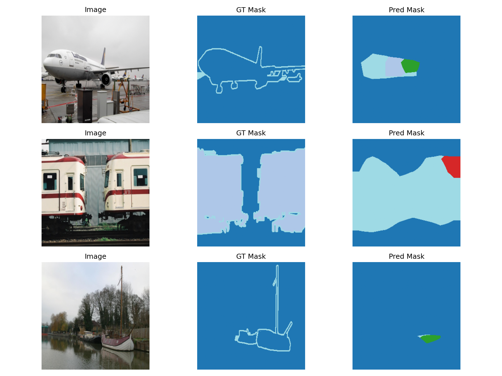
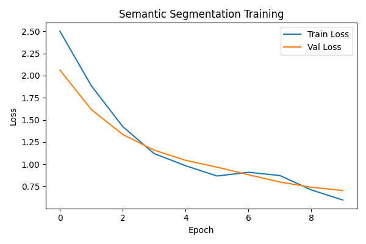

# Semantic Segmentation with FCN

Fully Convolutional Network (FCN-8s) for dense pixel-wise classification
on Pascal VOC dataset.

## Architecture
VGG16 backbone + upsampling layers with skip connections for
per-pixel class prediction.

## Installation
```bash
pip install -r requirements.txt
```

## Usage
```bash
python src/train.py
python src/evaluate.py
```

## Pretrained weights

The trained checkpoint is attached to the [v1.0 release](https://github.com/HessamKaveh/semantic-segmentation-fcn/releases/tag/v1.0) (not stored in git):

```bash
wget -P results https://github.com/HessamKaveh/semantic-segmentation-fcn/releases/download/v1.0/best_fcn.pt   # 65 MB
```

## Results

| Metric | Value |
|---|---|
| Validation cross-entropy, Pascal VOC 2012 (final epoch) | 0.703 |
| Epochs | 10 |

<p align="center"></p>

<p align="center"></p>

> mIoU is not computed yet, and 10 epochs is far shorter than the standard FCN schedule, so masks are still coarse.

## Author
Hessam Kaveh — Research Fellow, Italian Institute of Technology

## License

Released under the [MIT License](LICENSE).
