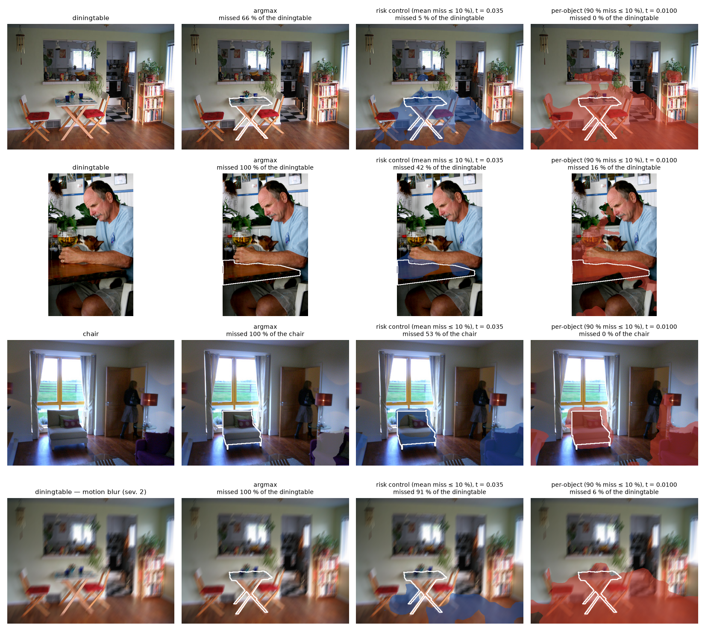
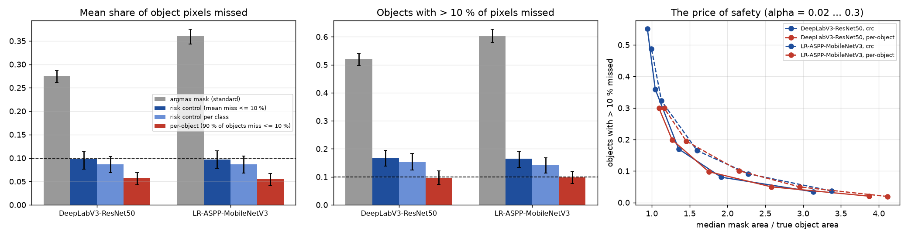
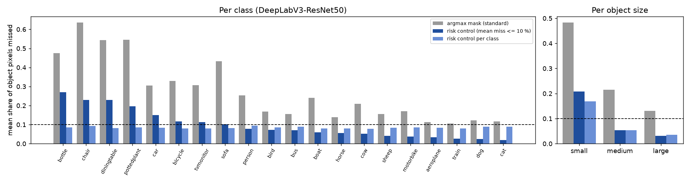
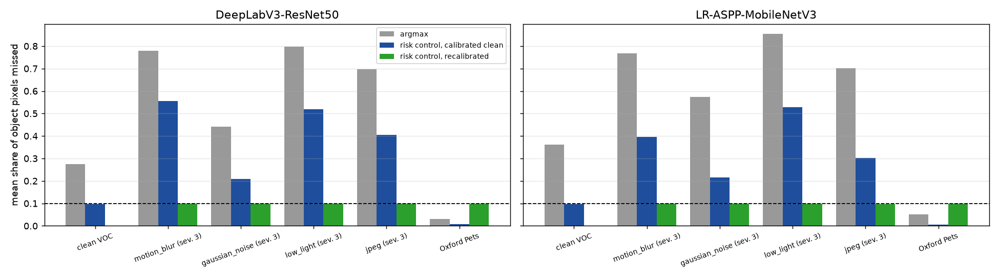

# Can a segmentation mask come with a guarantee?

[](https://github.com/HessamKaveh/segmentation-risk-control/actions/workflows/ci.yml)   [](LICENSE)

### Risk-controlled segmentation masks for robots, and what happens when the camera degrades

A robot that grasps, avoids or hands over an object needs to know **where the whole object is**. A segmentation mask
that misses a third of a table leg or a chair is a safety problem, not just a lower IoU. Standard segmentation networks
give no promise about how much of an object their mask misses.

This project tests whether **conformal risk control** (Angelopoulos et al., 2022) can turn an ordinary segmentation
network into one with a statistical guarantee on missed object pixels. It measures what that guarantee costs, who it
fails to protect, and whether it survives the corruptions a robot camera actually produces (motion blur, noise, low
light, JPEG) and a dataset shift (PASCAL VOC → Oxford-IIIT Pets).


*DeepLabV3 on VOC val. White outline: ground-truth object. Columns: the standard argmax mask, a mask calibrated so
that on average ≤ 10 % of object pixels are missed, and a mask calibrated so that ≥ 90 % of objects have ≤ 10 % missed.
The rows were picked among hard cases (argmax misses > 30 %) of hard classes. The last row is the first image with
motion blur, using thresholds calibrated on clean images.*

---

## Key findings

All numbers are on PASCAL VOC 2012 val: 1,449 images, 2,148 objects (one object = one class present in one image).
Calibration and test are a random 50/50 split by image, repeated 200 times. Brackets are 2.5 to 97.5 % ranges over
the repeats.

| # | Question | Finding |
|---|----------|---------|
| 1 | **How much of an object does a standard mask miss?** | A lot, even from a good model. DeepLabV3 (73.3 % mIoU) misses on average **27.6 %** [26.2, 28.7] of each object's pixels, and **52 %** of objects lose more than a tenth of their pixels. For small objects the mean miss is 48 %. |
| 2 | **Can a guarantee be bought, and at what price?** | Yes. Conformal risk control brings the mean miss down to **9.8 %** [7.7, 11.4] (target ≤ 10 %), with masks a median **1.36 ×** the true object area. A per-object guarantee (90 % of objects miss ≤ 10 %) holds at **9.7 %** [7.3, 12.1] of objects, but needs **1.75 ×** masks. |
| 3 | **Who is left unprotected by an average guarantee?** | Small objects and hard classes. With the average guarantee met, small objects still miss **20.8 %**, and bottle, chair, dining table and potted plant miss 20 to 27 %. Calibrating **per class** brings every class to ≤ 9.4 %, but small objects stay at 16.9 %. |
| 4 | **Does the guarantee survive a degraded camera?** | No. Calibrated on clean images, the "≤ 10 %" mask misses **56 %** under heavy motion blur, **52 %** in low light and **41 %** with strong JPEG. Even mild blur (severity 1) breaks it (18.7 %). The per-object guarantee degrades more slowly, but also fails (45 % under heavy blur). |
| 5 | **Does recalibrating on degraded images fix it?** | The guarantee comes back exactly (9.7 to 10.0 % in every condition), but the masks become useless: **3.9 to 5.5 ×** the object area at the heaviest blur, low light or JPEG. The guarantee is only as good as the model behind it. |
| 6 | **And under a dataset shift (VOC → Oxford Pets)?** | The opposite failure. Cats and dogs are easy, large objects, so the VOC-calibrated mask is **over-cautious** (0.7 % missed instead of 10 %). The guarantee holds, but at a precision cost. Shifts do not all break guarantees in the same direction. |

**Bottom line:** risk control is cheap to add (one threshold, about 700 calibration images) and does what it promises,
but only **on the data it was calibrated on, on average, and for the average object**. A robot that uses it needs a
calibration set from its own camera, a per-class (ideally per-size) calibration, and a way to detect when the image
has degraded.

---

## 1. Method

**Models.** Both are trained on VOC 2012 *train_aug* (10,582 images; SBD labels, val images excluded) from ImageNet
initialisation, with 384 × 384 crops, random scale 0.5 to 2, flips, SGD with poly decay and mixed precision. Testing
uses a flip at full resolution.

| model | iterations | VOC val mIoU |
|---|---|---|
| DeepLabV3, ResNet-50, output stride 16 | 20k, batch 8 | **73.3 %** |
| LR-ASPP, MobileNetV3-Large (real-time) | 15k, batch 16 | 68.2 % |

DeepLabV3 is a few points below published numbers (~76 to 77 %), because of the smaller crops and shorter schedule
on a 4 GB laptop GPU.

**Threshold masks.** For an object of class *c*, the mask is {pixels with softmax probability p<sub>c</sub> ≥ t}.
A lower *t* gives a larger mask with fewer missed pixels. `src/infer.py` stores, for every object, histograms of
p<sub>c</sub> over its pixels (interior and ≤ 3 px boundary) and over all other pixels, on a fixed grid of 1,000
thresholds. Any threshold can then be evaluated *exactly* without re-running the network. The miss rate is the
false-negative rate, FNR = share of the object's pixels outside the mask.

**How t is chosen** (`src/analyze.py`), with α = β = 0.1:

| method | rule | guarantee on new images |
|---|---|---|
| argmax | pixel goes to its most likely class | none |
| risk control (CRC) | largest t with n/(n+1)·mean FNR<sub>cal</sub>(t) + 1/(n+1) ≤ α | E[FNR] ≤ 10 % |
| CRC per class | the same, separately for each of the 20 classes | E[FNR \| class] ≤ 10 % |
| per-object | split-conformal quantile of each object's largest safe threshold | P(FNR ≤ 10 %) ≥ 90 % |

All of these guarantees assume that calibration and test images are exchangeable.

## 2. Results on clean VOC



| model | method | mean miss | objects missing > 10 % | median mask / object area |
|---|---|---|---|---|
| DeepLabV3 | argmax | 27.6 % | 52.0 % | – |
| DeepLabV3 | CRC | **9.8 %** | 16.9 % | 1.36 |
| DeepLabV3 | CRC per class | 8.6 % | 15.4 % | 1.31 |
| DeepLabV3 | per-object | 5.7 % | **9.7 %** | 1.75 |
| LR-ASPP | argmax | 36.1 % | 60.3 % | – |
| LR-ASPP | CRC | **9.6 %** | 16.5 % | 1.60 |
| LR-ASPP | CRC per class | 8.6 % | 14.2 % | 1.58 |
| LR-ASPP | per-object | 5.4 % | **9.9 %** | 2.17 |

* **Both guarantees hold**, and each holds for what it promises. CRC controls the *average* miss, but 17 % of objects
  still lose more than a tenth. The per-object rule controls exactly that share.
* **The two methods are not more or less efficient, they sit on the same trade-off curve** (right panel, α swept from
  0.02 to 0.3). They just pick different points on it. The real choice is which promise the robot needs.
* **A better model buys a tighter mask, not a safer one.** At the same guarantee, DeepLabV3's masks are 1.36 × the object
  vs 1.60 × for LR-ASPP.
* **The misses concentrate on boundaries:** within 3 px of the edge, the CRC mask misses 13.7 % vs 7.9 % in the interior.

### 2.1 Who an average guarantee leaves behind



| object size (DeepLabV3) | argmax | CRC | CRC per class |
|---|---|---|---|
| small (< 10,380 px) | 48.2 % | **20.8 %** | 16.9 % |
| medium | 21.4 % | 5.4 % | 5.4 % |
| large (> 34,620 px) | 13.0 % | 3.1 % | 3.6 % |

A single threshold gives the average object its guarantee by over-protecting large objects and under-protecting small
ones. Per-class calibration fixes the class imbalance: all 20 classes land between 7.8 and 9.4 %. It does not fix size.
Size-conditional calibration needs a size estimate at test time, for example from the predicted mask. This is left as
the obvious next step.

## 3. Under camera degradation and dataset shift



Thresholds are calibrated on clean VOC and applied to the same val images with a corruption (seeded, three
severities), or to the Oxford-IIIT Pet test set (3,669 images; cat/dog trimaps; the trimap's uncertain border is
ignored).

| condition (DeepLabV3) | mIoU | argmax miss | CRC miss (calibrated clean) | CRC miss (recalibrated) | recalibrated mask / object |
|---|---|---|---|---|---|
| clean | 73.3 | 27.6 % | 9.8 % | – | 1.36 |
| motion blur, sev. 1 / 3 | 59.5 / 21.8 | 39.6 / 77.9 % | **18.7 / 55.6 %** | 9.9 / 10.0 % | 2.29 / 5.04 |
| Gaussian noise, sev. 1 / 3 | 70.8 / 54.7 | 29.7 / 44.1 % | 11.1 / 20.8 % | 9.7 / 9.9 % | 1.45 / 2.65 |
| low light, sev. 1 / 3 | 67.8 / 21.6 | 34.2 / 79.7 % | 13.9 / **51.8 %** | 9.7 / 9.9 % | 1.66 / 5.50 |
| JPEG, sev. 1 / 3 | 67.7 / 34.8 | 34.8 / 69.8 % | 14.0 / 40.6 % | 9.7 / 9.9 % | 1.73 / 3.88 |
| Oxford Pets | – | 3.2 % | **0.7 %** | 9.9 % | 0.96 |

* **Every corruption breaks the clean guarantee, even at the mildest severity.** The model's probabilities shrink
  under degradation, so a threshold that was safe on clean images is too high.
* **Recalibration restores the guarantee exactly, in every condition, for both models.** Conformal methods do what they
  claim. The cost, however, is a mask 5 × the object under heavy blur or low light, which is useless for grasping.
  The right reaction to such images is to detect them and stop, not to segment them.
* **The per-object rule is more robust under shift** (blur sev. 3: 44.6 % vs 55.6 % miss), because it sits at a lower
  threshold, but it is not robust.
* **The Pets shift goes the other way:** large, easy objects make the VOC threshold over-cautious. Recalibrating on Pets
  data gives a *smaller* mask (0.96 × vs 1.05 ×) at exactly 10 % miss.

LR-ASPP shows the same pattern (`results/results.json`).

## Limitations

* The corruptions are synthetic. Real motion blur and sensor noise are spatially varying and correlated with scene
  content.
* VOC val is used for both calibration and test (disjoint images in every repeat). The guarantee is marginal over
  images *from VOC*. A robot would need calibration data from its own camera and scenes.
* "Objects" are class regions per image, not instances. Two chairs in one image are one object here, since VOC
  semantic labels do not separate instances.
* Only FNR is controlled. A mask could also be required to bound false positives (e.g. for free-space estimation),
  which leads to a two-sided problem.
* One training run per model.

## Reproduce

```bash
pip install -r requirements.txt
# VOC 2012 trainval + SBD "SegmentationClassAug" labels in $VOC_DIR; Oxford-IIIT Pet in $PETS_DIR (see src/data.py)
python src/train.py --model deeplabv3 --iters 20000    # ~1 h on an RTX 500 Ada (4 GB)
python src/train.py --model lraspp    --iters 15000    # ~45 min
python src/infer.py                                    # 14 conditions x 2 models -> cache/stats_*.npz
python src/analyze.py                                  # results/results.json + figures
python src/examples.py                                 # results/figures/examples.png
```

```
src/data.py         VOC train_aug / val, Oxford-IIIT Pet as VOC classes, seeded corrupted evaluation sets
src/corruptions.py  motion blur, Gaussian noise, low light, JPEG at three severities
src/model.py        DeepLabV3-ResNet50 and LR-ASPP-MobileNetV3
src/train.py        training
src/infer.py        per-object probability histograms (any threshold evaluable afterwards)
src/analyze.py      CRC, per-class CRC, per-object conformal; subgroups; shift; figures
src/examples.py     example masks
```

The earlier version of this repository (an FCN baseline) is still in the git history, and its weights are in the
`v1.0` release. They are not used here. Oxford-IIIT Pet appears here only as a shift test. The former stand-alone
pet-segmentation project is superseded by this one.

## References

* Angelopoulos, Bates, Fisch, Lei, Schuster. *Conformal Risk Control.* ICLR 2024 (arXiv 2022).
* Angelopoulos, Bates, Candès, Jordan, Lei. *Learn then Test: Calibrating Predictive Algorithms to Achieve Risk Control.* 2021.
* Chen, Papandreou, Schroff, Adam. *Rethinking Atrous Convolution for Semantic Image Segmentation* (DeepLabV3). 2017.
* Howard et al. *Searching for MobileNetV3* (LR-ASPP). ICCV 2019.
* Everingham et al. *The PASCAL Visual Object Classes Challenge.* IJCV 2010. Hariharan et al. *Semantic Contours from Inverse Detectors* (SBD). ICCV 2011.
* Parkhi, Vedaldi, Zisserman, Jawahar. *Cats and Dogs* (Oxford-IIIT Pet). CVPR 2012.
* Hendrycks, Dietterich. *Benchmarking Neural Network Robustness to Common Corruptions and Perturbations.* ICLR 2019.

## Citation

If you use this code, please cite it (metadata in [`CITATION.cff`](CITATION.cff)):

```bibtex
@software{kaveh2026_segmentation_risk_control,
  author  = {Kaveh, Hessam},
  title   = {Can a segmentation mask come with a guarantee?},
  year    = {2026},
  version = {1.0.0},
  url     = {https://github.com/HessamKaveh/segmentation-risk-control},
  license = {MIT}
}
```

---

**Author:** Hessam Kaveh, Research Fellow, Italian Institute of Technology (IIT)

License: MIT
